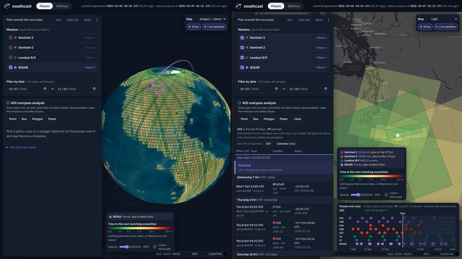

# swathcast

**Upcoming satellite acquisitions and time until data delivery.**

swathcast shows when Sentinel-1, Sentinel-2, Landsat 8/9 and NISAR will next image a place, read
from the agencies' own acquisition plans, and when MODIS (Terra, Aqua), VIIRS (Suomi NPP, NOAA-20,
NOAA-21) and Sentinel-3 (OLCI, SLSTR) will, predicted from their orbits (they image on every orbit
and have no plans), and how long each data source takes to deliver the products, measured every
hour. It is built for planning near-real-time monitoring (wet snow and
snowmelt, for example), field campaigns, and coordination between missions.

**Live site: <https://egagli.github.io/maps/swathcast.html>**



## What you can do

### Passes: the next acquisition over any place

- **See every mission's native footprints**, each coloured by how long until it is next imaged:
  Sentinel-1 IW bursts (ESA/OPERA burst IDs, e.g. `T137-292398-IW2`, timed to the second) and EW/SM
  swaths, Sentinel-2 MGRS tiles, Landsat 8/9 WRS-2 scenes and NISAR frames; MODIS, VIIRS and
  Sentinel-3 on the MODIS sinusoidal tiles (the grid of the MODIS/VIIRS land and snow products).
- **Filter per mission**: platform, direction (labelled with each mission's local solar time, e.g.
  Sentinel-1 ascending ~6 PM, descending ~6 AM), Sentinel-1 mode, track/path, burst/tile/row/frame,
  and for the SAR missions the real polarization channels (e.g. VV+VH, or HH+HV+VH+VV; for NISAR per
  radar, L-band and S-band). Dates are shared across missions. Landsat's ascending (night, thermal
  only) passes are off by default. MODIS, VIIRS and Sentinel-3 filter by **light** (day or night at
  the place; night off by default; each platform labelled with its daytime equator crossing in local
  solar time, from its current orbit: Terra and Aqua have drifted), MODIS and VIIRS also by **maximum view zenith angle** (their
  pixels grow 2–5× towards the swath edges), Sentinel-3 by relative orbit and frame.
- **Draw or paste an area of interest** (GeoJSON, WKT or `west,south,east,north`; one crossing 180°
  is split there) to get one list from now outwards: its planned passes, soonest first, then its
  acquisitions of the last 90 days (Sentinel-1 IW, EW and stripmap), newest first. A pass already
  imaged but not yet in any catalogue stays listed until it is delivered. A timeline along the bottom
  of the map shows the same, one lane per satellite; selecting a pass in either highlights it in both.
  MODIS, VIIRS and Sentinel-3 passes are timed at the AOI itself, kept only if their swath reaches
  it, and listed with the view zenith angle there (and for Sentinel-3 the products' frame and which
  instruments see the AOI: SLSTR, and OLCI in daylight within its narrower strip); a selected pass
  highlights the strip it images around the AOI.
- **Open any footprint's timeline**: its acquisitions of the last 90 days, read live from the
  catalogues (real products only), each linked to the product, and its planned ones. NISAR frames
  and Landsat scenes are outlined as their latest real products were, not as planned.
- **Preview a product on the map**: its browse image is draped over the footprint and can be
  reordered, faded and removed (Sentinel-1 in colour or one channel, VV or VH; MODIS and VIIRS: the
  true colour from [NASA Worldview](https://worldview.earthdata.nasa.gov/), within the tile: the
  pass's own granules for SNPP and NOAA-20, the day's mosaic otherwise; at night, the night's
  thermal mosaic (MODIS band 31, VIIRS I5) and for SNPP and NOAA-20 also the Day/Night Band;
  Sentinel-3: CDSE's quicklook of the frame, placed from the orbit: OLCI's true colour by day,
  SLSTR's thermal at night).
- **Watch the satellites**: a globe (or flat map) shows where each selected satellite is now, at its
  altitude, with its orbit and the strip of ground its instrument sees (side-looking for the radars),
  filled while the plan has it imaging. Zoomed out, Sentinel-1/2 show their planned datatake swaths,
  and the legend says, per mission, what is shown, from which zoom its footprints appear and where
  its plan ends. The globe draws footprints up to the poles; the flat map stops at 85°. Basemaps are
  Esri Gray Canvas (the default), Esri World Imagery (with or without labels), Esri World Topographic
  and OpenStreetMap.
- **Share and export**: the page's state (AOI, missions, filters, dates) lives in the URL, so
  **Copy link** shares it; an AOI's passes can be saved as CSV or as a calendar (`.ics`, one event per
  pass with its likely download time). Optical passes show the sun's elevation at the AOI. Times are
  shown in UTC and in local time at the AOI. A source whose poller is failing is marked ⚠; **Reset**
  starts the page over.

### Delivery: when a product will be downloadable

- **For each pass over an AOI**, see when it is likely to be downloadable from each source (for
  Sentinel-1: ESA CDSE, ASF, Microsoft Planetary Computer and OPERA RTC-S1/CSLC-S1; for MODIS and
  VIIRS: NASA LANCE near-real-time, LAADS and NSIDC; for Sentinel-3: CDSE near-real-time and
  non-time-critical, EUMETSAT and Planetary Computer), from delivery
  latency **measured by this repository's own hourly poller**, never estimated from documentation.
- **For each recent acquisition**, every source's catalogue is searched live from the browser, with
  links to the products already up and expected times for the rest. USGS's Landsat STAC does not
  answer browsers, so the poller publishes the last 90 days of Level-1 scenes per WRS-2 path for the
  map to read; ISRO's Bhoonidhi needs a login, so the poller publishes its NISAR S-band listing the same
  way (the popup's history), and for the products only the expected time is shown.
- **The [dashboard](https://egagli.github.io/swathcast/dashboard.html)** shows the measured
  distributions for Sentinel-1, Sentinel-2 (CDSE, Earth Search, Planetary Computer, HLS S30),
  Landsat 8/9 (USGS, Earth Search, Planetary Computer, HLS L30), NISAR (ASF L0B, RSLC and GCOV
  for L-band; ISRO Bhoonidhi RSLC and GCOV for S-band), MODIS and VIIRS (Level-1B at LANCE and LAADS,
  snow cover at LANCE and NSIDC) and Sentinel-3 (OLCI EFR and SLSTR RBT at CDSE and EUMETSAT, OLCI LFR
  and SLSTR LST at CDSE and Planetary Computer).


## Footprints and timing

| Sensor | Footprint shown | Time |
|---|---|---|
| Sentinel-1 IW | ESA burst grid (ASF's `Sentinel-1_Burst_Map`, fetched live from CMR for the AOI or view) | exact to about a second: plan datatake + ANX orbit timing fitted from CDSE products (see [methodology](docs/methodology.md#sentinel-1-burst-timing)) |
| Sentinel-1 EW/SM | the planned datatake, clipped to the area around the AOI | datatake start |
| Sentinel-2 | ESA's MGRS tiling grid (56,686 tiles) | when the satellite's orbit (CelesTrak elements, SGP4) passes the tile during a planned datatake: median 0.4 s, max 8.6 s from real sensing times (see [methodology](docs/methodology.md#sentinel-2-tile-timing)) |
| Landsat 8/9 | WRS-2 scenes on USGS's acquisition calendar (paths *and rows* per day) | the pass nearest the scene centre on that date (SGP4): median 0.3 s, p99 6 s from 4,707 USGS scene times ([methodology](docs/methodology.md#landsat-and-nisar-timing)) |
| NISAR | track/frame from NASA's observation plan, with polarization | the pass with the frame ~567 km to its left on that date (SGP4): median 0.65 s, p95 14 s from 2,804 RSLC granules |
| MODIS, VIIRS | MODIS sinusoidal tiles (460); no plan: every pass whose swath (measured: ±1,171–1,548 km) covers the tile centre | closest approach to the tile centre (SGP4), then at the AOI itself: 1,491 of 1,512 predicted tile passes were real LANCE granules (14 of the 21 misses during LANCE outages), and the browser's timing matches the schedule's to under 1 s ([methodology](docs/methodology.md#modis-viirs-and-sentinel-3-timing)) |
| Sentinel-3 | the same tiles; each pass labelled with its products' frame (relative orbit, seconds after the node) | as MODIS; frames from the orbit: 1,438 of 1,450 CDSE products matched, full frames within 0.12 s |

The plans themselves have datatakes up to 54°/116° of latitude long (S1/S2), per-day paths (Landsat)
and per-date frames (NISAR); this site resolves them to the footprints above. Times are shown in UTC and in the civil time zone at the
AOI or footprint ([tz-lookup](https://github.com/photostructure/tz-lookup)).

## How "latency" is defined

> **latency = time our hourly poller first found the granule at a source − the granule's sensing
> start.**

- It is the one definition shared by every source; providers' own timestamps are recorded next to it
  as a cross-check only (see [docs/sources.md](docs/sources.md): ASF's CMR insert date, for one,
  changes when a granule is re-ingested).
- Resolution is about ±1 h (the poll interval).
- The tracking universe is CDSE's publication stream. A source *faster* than CDSE cannot be
  distinguished from it.
- For Planetary Computer and OPERA, which do not process every acquisition, only orbit cells in which
  the source has delivered at least once count; "% not delivered" there means failures inside the
  area the source serves.
- OPERA products are per burst: the headline is the *first* burst of an acquisition; the dashboard
  also shows the *last* burst.
- For MODIS and VIIRS the universe is NASA LANCE's near-real-time Level-1B stream (by CMR insert);
  for Sentinel-3, CDSE's near-real-time OLCI/SLSTR Level-1 frames. Their Level-2 snow, land (LFR) and
  temperature (LST) products are made for daytime or land granules only and count on learned coverage.
- Expected availability for a pass = the time your AOI is imaged (for Sentinel-1 IW, the first burst
  over the AOI; for MODIS, VIIRS and Sentinel-3 the pass timed at the AOI; otherwise the pass start) +
  the source's latency quantile over the last 30 days. It is a planning aid, not a guarantee.

## Documentation

- [Data sources](docs/data-sources.md): where every number on the site comes from, per mission, with
  links to each source and its terms.
- [Methodology](docs/methodology.md): how passes are timed and how delivery latency is measured.
- [Source notes](docs/sources.md): what each API returns and how identifiers are matched, as checked
  against the live services.
- [Development](docs/development.md): how the jobs run, the code layout, and how to add a source.

## Run it locally

Requires [pixi](https://pixi.sh). Python ≥ 3.11; environments are locked in `pixi.lock`.

```bash
pixi install                                   # default env (schedule + poller + tests)
pixi run test                                  # offline unit tests
pixi run test-live                             # smoke tests against the real APIs
pixi run lint

pixi run schedule --days 30 --output x.parquet # plans (+ x.meta.json and the grids beside it)
pixi run poll --data-dir data                  # one poller pass (run it hourly)
pixi run summarize --data-dir data --out site-data
pixi run viewer --schedule x.parquet --latency site-data/latency.json
```

The viewer serves the same pages as the live site at `http://127.0.0.1:8472/`. To view the live data
locally, clone the `data` branch (`git clone -b data --depth 1
https://github.com/egagli/swathcast data`) and summarise it.

## Citing

If you use swathcast, please cite it with the metadata in [CITATION.cff](CITATION.cff) (GitHub's
"Cite this repository" button reads it).

## Acknowledgments

swathcast was inspired by [`next_pass`](https://github.com/OPERA-Cal-Val/next_pass) from the OPERA
project. The code was largely written by claude code.

## License

The code is Apache-2.0 (see [LICENSE](LICENSE) and [NOTICE](NOTICE)). The site's data are metadata
derived from the providers' plans and catalogues; each provider's terms apply
([data sources](docs/data-sources.md#terms-and-attribution)). Contains modified Copernicus Sentinel
data processed by ESA.
